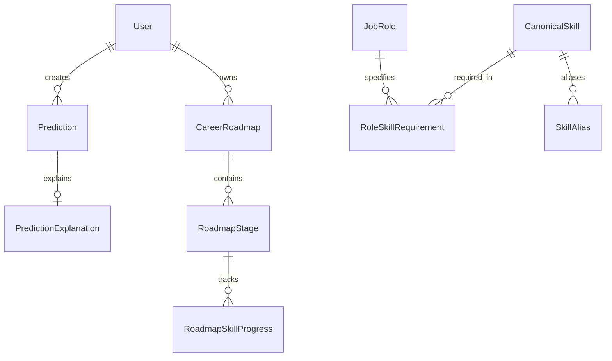

# WorthIQ — Phase 3 Implementation Plan
## AI Intelligence Engine: SHAP Explainability, Skill Impact Analysis, Job Role Matching & Career Growth Roadmaps

**Project:** WorthIQ: Skill-Based Salary Potential & Career Growth Analyzer  
**Date:** November 23, 2026  
**Document Version:** 1.0.0  
**Phase:** Phase 3 Master Implementation  

---

## 1. Existing Architecture Analysis

WorthIQ has established an enterprise full-stack architecture across Phases 1 and 2:
- **Frontend:** React 18 + Vite 6 running on strict port `5180`. State is handled via `AuthContext` (JWT session management with automatic refresh interceptors) and clean SaaS Tailwind CSS layout. Recharts is installed and configured.
- **Backend:** Python 3.14 + Django 5.2 + Django REST Framework on `http://localhost:8000`. Modular architecture with `apps.accounts`, `apps.profiles`, and `apps.predictions`.
- **Database:** PostgreSQL 16 Alpine containerized on port `5432` (`worthiq_db`). All entities use Django ORM with composite indexes, foreign key constraints, and user isolation.
- **Machine Learning System:** Production artifacts in `ml/models/` (`salary_model.joblib` [Random Forest with 150 estimators], `preprocessing_pipeline.joblib`, `quantile_models/` [P10, P50, P90], and `model_metadata.json`). Target variable is $\log(1+y)$ normalized.

---

## 2. Existing Implementation Inventory

| Module / Component | File / Path | Current State & Reuse in Phase 3 |
|---|---|---|
| **User & Profile Models** | `backend/apps/accounts/models.py`, `apps/profiles/models.py` | Reused for user authentication and user profile/skill attributes. |
| **Salary Prediction Model** | `backend/apps/predictions/models.py` (`Prediction`) | Linked to individual SHAP explanations and historical records. |
| **Model Loader & Inference** | `apps/predictions/services/model_loader.py`, `salary_prediction.py` | In-memory singleton `MLModelRegistry` reused for SHAP TreeExplainer and counterfactual evaluations. |
| **Preprocessed Dataset** | `ml/data/processed/salary_features_dataset.csv` | Reused for global SHAP evaluations, role matching catalog calibration, and skill co-occurrence mining. |
| **Salary Analysis UI** | `frontend/src/pages/SalaryAnalysisPage.jsx` | Reused; links to individual prediction SHAP explanations. |
| **Saved Reports UI** | `frontend/src/pages/SavedReportsPage.jsx` | Reused; links directly to explanation modal/page. |

---

## 3. Phase 3 Feature Breakdown

Phase 3 introduces four core intelligence modules:

### Module A: Explainable AI Using SHAP
- **Core Technology:** `shap.TreeExplainer` initialized on `RandomForestRegressor` from `ml/models/salary_model.joblib`.
- **Scale Consistency:** Explanations compute SHAP values in the model's native log-transformed prediction space $\phi_i$ where $\sum \phi_i = \hat{y} - E[y]$. For user clarity in the UI, both the dimensionless SHAP log-odds/log-salary impact and approximate marginal INR impact are reported with clear labels and disclaimers.
- **Global Explainability:** Offline/pre-computed global summary plots, feature importance rankings, and skill rankings saved to `ml/explainability/`.
- **Local Explainability:** Real-time per-prediction SHAP explanations cached in the `PredictionExplanation` database table to eliminate redundant heavy computation.
- **Visuals:** Waterfall attribution chart, positive/negative factor bar charts, and feature impact rankings.

### Module B: Skill Impact Analysis & Skill Intelligence
- **Skill Normalization:** Normalized taxonomy with `CanonicalSkill` and `SkillAlias` (e.g. `JS` $\rightarrow$ `JavaScript`, `ReactJS` $\rightarrow$ `React.js`). Categorized into Programming Languages, Frontend, Backend, Databases, Cloud & DevOps, Data & AI.
- **Quantified Skill Impact:** Counterfactual ablation evaluation on the trained model holding all other candidate features constant, paired with dataset salary distributions.
- **Skill Co-Occurrence:** Pairwise co-occurrence matrix, support, and confidence scores across the 25,332 verified records.
- **Frontend Dashboard:** Skill portfolio breakdown, category radar/bars, high-impact skills, and co-occurrence insights.

### Module C: AI-Based Job Role Matching
- **Role Catalog:** Grounded in dataset roles (`Software Developer`, `Full Stack Developer`, `Backend Developer`, `Frontend Developer`, `Data Scientist`, `Data Analyst`, `DevOps Engineer`, `Machine Learning Engineer`, plus specialized tracks like `Cloud Engineer`).
- **Matching Algorithm:** Multi-dimensional scoring combining:
  1. Required skill coverage (weight: 0.40)
  2. TF-IDF + Cosine similarity over skill embeddings (weight: 0.35)
  3. Experience compatibility score (weight: 0.25)
- **Output:** Normalized match score (0–100%), Match Category (`Strong Match`, `Good Match`, `Moderate Match`, `Low Match`), matched skills, missing required skills, and missing preferred skills.

### Module D: Personalized Career Growth Roadmaps
- **Gap Analysis:** Direct comparison of user skills with target role specifications, cataloging possessed, missing required, and missing preferred skills.
- **Skill Dependency Graph (DAG):** Non-circular dependency ordering (e.g., Programming Fundamentals $\rightarrow$ Python $\rightarrow$ Django $\rightarrow$ REST APIs $\rightarrow$ Backend Architect).
- **Phased Stages:** Structured 4–5 stage milestones with clear objectives, required skills, practical project specifications, and completion criteria.
- **Persistence & Progress:** Users can generate, save, mark skills/stages as completed, and track overall completion percentage in PostgreSQL.

---

## 4. New Backend Components (`backend/apps/intelligence/`)

```
backend/apps/intelligence/
├── __init__.py
├── apps.py
├── admin.py
├── models.py                   # CanonicalSkill, SkillAlias, JobRole, RoleSkillRequirement,
│                               # SkillCoOccurrence, PredictionExplanation, CareerRoadmap,
│                               # RoadmapStage, RoadmapSkillProgress
├── serializers.py              # DRF serializers for all intelligence entities
├── urls.py                     # Route registrations under /api/intelligence/
├── permissions.py              # IsOwnerOrReadOnly / IsResourceOwner
├── services/
│   ├── __init__.py
│   ├── shap_service.py         # TreeExplainer wrapper, local/global attribution, log-to-INR mapping
│   ├── skill_normalization_service.py # Canonical alias resolution and taxonomy
│   ├── skill_impact_service.py # Counterfactual evaluations, marginal premium
│   ├── skill_cooccurrence_service.py # Co-occurrence mining and pair insights
│   ├── role_matching_service.py # TF-IDF + Cosine similarity + skill overlap
│   ├── skill_gap_service.py    # Target role vs user skill delta
│   └── roadmap_service.py      # DAG ordering, stage generation, project suggestions
├── views/
│   ├── __init__.py
│   ├── explanations.py         # GET /api/intelligence/explanations/{prediction_id}/
│   ├── skills.py               # GET /api/intelligence/skills/, /impact/, /co-occurrence/, POST /compare/
│   ├── roles.py                # GET /api/intelligence/roles/, POST /match/, GET /recommendations/
│   └── roadmaps.py             # POST /generate/, GET /roadmaps/, GET/PATCH/DELETE /{id}/
└── tests/
    ├── __init__.py
    ├── test_explanations.py
    ├── test_skills.py
    ├── test_role_matching.py
    └── test_roadmaps.py
```

---

## 5. Database Schema & Changes



1. **`CanonicalSkill`**: `name`, `category`, `description`, `market_importance_tier`.
2. **`SkillAlias`**: `alias`, `canonical_skill` (FK).
3. **`JobRole`**: `title`, `description`, `min_exp`, `max_exp`, `median_salary`, `dataset_coverage_count`.
4. **`RoleSkillRequirement`**: `role` (FK), `skill` (FK), `is_mandatory` (boolean), `importance_weight`.
5. **`SkillCoOccurrence`**: `skill_a` (FK), `skill_b` (FK), `pair_count`, `support_pct`, `confidence_pct`.
6. **`PredictionExplanation`**: `prediction` (OneToOneField to `Prediction`), `base_value`, `predicted_value`, `feature_attributions` (JSON), `positive_contributors` (JSON), `negative_contributors` (JSON), `summary_text`, `model_version`.
7. **`CareerRoadmap`**: `user` (FK), `current_role`, `target_role` (FK), `title`, `overall_progress_pct`, `is_saved`, `created_at`, `updated_at`.
8. **`RoadmapStage`**: `roadmap` (FK), `stage_number`, `title`, `objective`, `project_suggestion` (JSON), `is_completed`.
9. **`RoadmapSkillProgress`**: `stage` (FK), `skill_name`, `is_completed`, `completed_at`.

---

## 6. API Design

| Module | Method | Endpoint | Description | Auth |
|---|---|---|---|---|
| **SHAP** | `GET` | `/api/intelligence/explanations/{prediction_id}/` | Get/compute SHAP explanation for a prediction | Yes |
| **SHAP** | `GET` | `/api/intelligence/explanations/global/` | Global feature impact and summary plots | No |
| **Skills** | `GET` | `/api/intelligence/skills/` | Full skill taxonomy & categories | No |
| **Skills** | `GET` | `/api/intelligence/skills/impact/` | Skill valuation & marginal premium ranking | Yes |
| **Skills** | `GET` | `/api/intelligence/skills/co-occurrence/` | Pairwise co-occurrences & bundle insights | No |
| **Skills** | `POST` | `/api/intelligence/skills/compare/` | Controlled counterfactual comparison | Yes |
| **Roles** | `GET` | `/api/intelligence/roles/` | Catalog of technology job roles | No |
| **Roles** | `GET` | `/api/intelligence/roles/{id}/` | Single role detail & requirements | No |
| **Roles** | `POST` | `/api/intelligence/roles/match/` | AI matching score against user profile | Yes |
| **Roles** | `GET` | `/api/intelligence/roles/recommendations/` | Top matching roles for authenticated user | Yes |
| **Roadmaps** | `POST` | `/api/intelligence/roadmaps/generate/` | Generate personalized career roadmap | Yes |
| **Roadmaps** | `GET` | `/api/intelligence/roadmaps/` | List user's saved career roadmaps | Yes |
| **Roadmaps** | `GET` | `/api/intelligence/roadmaps/{id}/` | Retrieve full roadmap with stages & progress | Yes |
| **Roadmaps** | `PATCH` | `/api/intelligence/roadmaps/{id}/progress/` | Update stage/skill completion status | Yes |
| **Roadmaps** | `DELETE` | `/api/intelligence/roadmaps/{id}/` | Delete saved roadmap | Yes |

---

## 7. New Frontend Components (`frontend/src/`)

1. **`PredictionExplanationPage.jsx`** (`/explanations/:predictionId`):
   - Salary prediction context summary card.
   - Interactive waterfall attribution chart via Recharts.
   - Positive impact factor list with green badges and exact weights.
   - Negative/limiting factor list with amber badges.
   - Log-odds vs INR conversion explanation and statistical disclaimers.
2. **`SkillIntelligencePage.jsx`** (`/skill-intelligence` / `/skill-impact`):
   - Portfolio skill radar/category distribution.
   - High-impact skills ranking table with dataset premium.
   - Missing high-value skills recommendations.
   - Interactive skill co-occurrence network/matrix.
   - Controlled What-If skill add/remove counterfactual comparison.
3. **`RoleMatchingPage.jsx`** (`/job-matching` / `/role-matching`):
   - One-click profile synchronization.
   - Filterable role recommendations cards with circular/gauge match score.
   - Matched skills (green) vs Missing required (red) vs Missing preferred (amber).
   - Experience compatibility indicator.
   - "Generate Career Roadmap" direct CTA linking to target role.
4. **`CareerRoadmapPage.jsx`** (`/career-roadmap`, `/roadmaps/:id`):
   - Current role vs Target role milestone path.
   - Overall progress bar and stage milestone timeline.
   - Collapsible stages with objectives and interactive skill checkmarks.
   - Practical real-world project brief per stage.
   - Save, load, and delete roadmap controls.

---

## 8. Implementation Sequence

1. **Stage 1:** Pre-implementation inspection & plan creation (`PHASE_3_IMPLEMENTATION_PLAN.md`).
2. **Stage 2:** SHAP explainability engine (`shap_service.py`, global explainability script, local explainability generator).
3. **Stage 3:** Skill normalization, impact service, and co-occurrence analysis (`skill_normalization_service.py`, `skill_impact_service.py`, `skill_cooccurrence_service.py`).
4. **Stage 4:** Job role catalog and role matching engine (`role_matching_service.py`, `skill_gap_service.py`).
5. **Stage 5:** Career roadmap DAG engine and stage generator (`roadmap_service.py`).
6. **Stage 6:** PostgreSQL database models, migrations, views, and REST URLs (`apps/intelligence/`).
7. **Stage 7:** Frontend services and React pages (`predictionService.js`, `intelligenceService.js`, pages, routing, navigation).
8. **Stage 8:** Unit, integration, and regression testing (`ml/tests/`, Django test suite, `npm run build`).
9. **Stage 9:** Bug fixes and verification.
10. **Stage 10:** Comprehensive documentation suite and `PHASE_3_IMPLEMENTATION_REPORT.md`.
