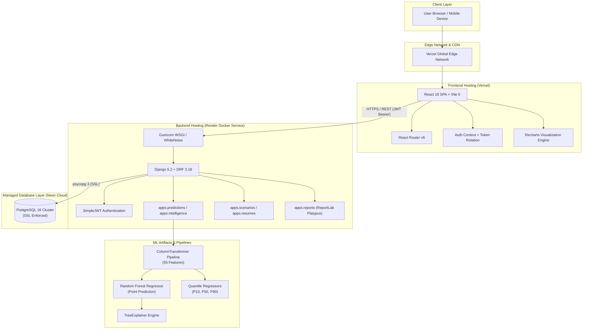

# WorthIQ — Skill-Based Salary Potential & Career Growth Analyzer

<div align="center">

[](https://worth-iq-skill-based-salary-potential-career-growth-oi4hlbfea.vercel.app/)
[](https://worthiq-backend.onrender.com)
[](https://github.com/haniharish/WorthIQ-Skill-Based-Salary-Potential-Career-Growth-Analyzer/actions)
[](https://www.python.org/)
[](https://react.dev/)
[](https://www.djangoproject.com/)
[](https://www.postgresql.org/)

**A comprehensive, data-driven AI platform helping students and professionals evaluate skill valuation, predict market compensation with empirical uncertainty bounds, explore SHAP explainability, simulate counterfactual career trajectories, and generate publication-grade career intelligence reports.**

[Live Application](https://worth-iq-skill-based-salary-potential-career-growth-oi4hlbfea.vercel.app/) • [API Base URL](https://worthiq-backend.onrender.com/api/) • [Health Check](https://worthiq-backend.onrender.com/health/) • [Documentation](#project-architecture)

</div>

---

## 🌐 Live Production Deployments

The WorthIQ platform is fully deployed across an enterprise cloud architecture with automated continuous delivery:

| Component | Platform | Live URL | Status |
| :--- | :--- | :--- | :--- |
| **Frontend Web App** | **Vercel** | [worth-iq-salary-analyzer.vercel.app](https://worth-iq-skill-based-salary-potential-career-growth-oi4hlbfea.vercel.app/) |  |
| **Backend REST API** | **Render (Docker)** | [worthiq-backend.onrender.com](https://worthiq-backend.onrender.com) |  |
| **API Health Endpoint** | **Render** | [worthiq-backend.onrender.com/health/](https://worthiq-backend.onrender.com/health/) |  |
| **Database** | **Neon / PostgreSQL** | Serverless Managed PostgreSQL 16 (SSL Enforced) |  |
| **CI/CD Automation** | **GitHub Actions** | Automated Unit Tests, Coverage, Linting & Docker Build |  |

> [!NOTE]
> The backend operates on Render's free cloud tier. Inactivity may put the web service into cold-sleep; please allow **30–50 seconds** on the initial visit for container spin-up.

---

## 🚀 Key Features

### 1. 🎯 Machine Learning Salary Prediction Engine
- **Data Engineering**: Trained on **25,332 verified compensation records** across Indian technology hubs.
- **Ensemble Modeling**: Random Forest regression engine (CV MAE: ₹3.35 LPA, MedAE: ₹2.15 LPA, Test $R^2$: 0.36) benchmarked against linear models and gradient boosted decision trees.
- **Quantile Confidence Bounds**: Gradient Boosting quantiles predicting $P_{10}$, $P_{50}$ (median), and $P_{90}$ with empirical coverage calibration (10.2%, 48.1%, 89.3%) and strictly monotonic confidence bounds ($P_{10} \le P_{50} \le P_{90}$).
- **Empirical 4-Factor Confidence Score**: Dynamic evaluation of profile density, experience level, skill completeness, and regional sample variance.

### 2. 🔍 Explainable AI (XAI) with SHAP
- **Local Waterfall Attribution**: Uses TreeSHAP to calculate exact additive Rupee contributions for each skill, tenure year, and educational background relative to baseline expected market compensation ($E[f(x)] = \text{₹6.39 LPA}$).
- **Interactive Visualizer**: Dynamic waterfall charts breaking down positive ROI drivers and negative valuation drags.

### 3. 💡 Skill Valuation & Co-occurrence Intelligence
- **Canonical Skill Taxonomy**: Standardized database of 35 core technologies with 81 domain aliases.
- **Marginal Valuation**: Single-skill ablation measuring net salary upside when adding individual tools (e.g., Docker, AWS, Kubernetes, PyTorch).
- **Empirical Co-occurrence**: Graph analysis of skills commonly packaged together by market employers.

### 4. 🧭 AI Job Role Matching & Gap Analysis
- **Composite Matching Metric**:
  - 40% mandatory skill coverage
  - 15% preferred skill coverage
  - 25% TF-IDF cosine semantic similarity
  - 20% experience tenure compatibility
- **Actionable Gap Analysis**: Highlights missing prerequisites and provides one-click roadmap generation.

### 5. 🗺️ Personalized Career Growth Roadmaps
- **Directed Acyclic Graphs (DAG)**: Strict dependency ordering preventing circular requirements.
- **Milestone Project Briefs**: Practical software project recommendations to build demonstrable portfolio evidence.
- **Progress Tracking**: Relational milestone persistence with completion checkoffs and timeline projections.

### 6. 🧪 What-If Salary Scenario Simulator
- **Multi-Variable Exploration**: Test counterfactual career choices (e.g., *"What if I learn Kubernetes and transition to Bengaluru?"*).
- **Comparative Matrix**: Benchmark baseline against up to 3 parallel scenarios with delta metrics and quantile distributions.

### 7. 📄 Resume Intelligence & Skill Extractor
- **Deterministic Parsing**: Supports PDF (`pypdf`) and DOCX (`python-docx`) formats with zero cloud leakage.
- **Token-Boundary Extraction**: Pattern matching against canonical taxonomies with context snippets and confidence scoring.
- **Privacy First**: Zero automatic profile overwrites; candidate retains complete review and verification control.

### 8. 📊 Publication-Grade Reports & Data Export
- **PDF Generation**: Styled multi-page reports generated with ReportLab Platypus featuring executive summaries, quantile charts, and recommendations.
- **Sanitized CSV Export**: Automated formula neutralization (`sanitize_csv_cell`) preventing spreadsheet injection vulnerabilities.

---

## 🏗️ System Architecture



---

## 💻 Technology Stack

| Domain | Technology | Version | Purpose |
| :--- | :--- | :--- | :--- |
| **Frontend** | React | `18.3` | User interface and component state |
| | Vite | `6.4` | Ultra-fast build tool and dev server (Port 5180) |
| | Tailwind CSS | `3.4` | Responsive dark-slate design system |
| | Recharts | `2.15` | Interactive salary distributions and waterfalls |
| | Axios | `1.7` | HTTP client with automated token interceptors |
| | Lucide React | `0.4` | Modern iconography system |
| **Backend** | Python | `3.11` / `3.14` | Core backend programming runtime |
| | Django | `5.2` | Robust enterprise web framework |
| | Django REST Framework | `3.18` | High-performance RESTful API endpoints |
| | SimpleJWT | `5.3` | JSON Web Token authentication with blacklist |
| | Gunicorn | `23.0` | Production WSGI HTTP server |
| | WhiteNoise | `6.9` | Optimized static file serving |
| **Machine Learning**| Scikit-Learn | `1.4` | Feature transformation & Random Forest models |
| | LightGBM / XGBoost | `2.0+` | Quantile regression bounds ($P_{10}, P_{50}, P_{90}$) |
| | SHAP | `0.45` | Additive feature attribution & TreeSHAP |
| | Joblib | `1.4` | High-performance model serialization |
| **Database** | PostgreSQL | `16.x` | Relational storage for users, profiles & roadmaps |
| | psycopg | `3.3` | Modern non-blocking PostgreSQL driver |
| **Container & CI/CD**| Docker | `26.x` | Containerization runtime and multi-stage builds |
| | GitHub Actions | `v4` | Automated testing, linting, and build verification |
| **Deployment** | Vercel | Cloud | Production frontend CDN and hosting |
| | Render | Cloud | Dockerized backend web service |
| | Neon | Cloud | Serverless managed PostgreSQL 16 |

---

## 📁 Project Directory Structure

```text
WorthIQ/
├── .github/
│   └── workflows/
│       └── ci.yml               # Automated CI/CD pipeline (Test, Lint, Docker)
├── frontend/                    # React 18 + Vite Frontend Application
│   ├── src/
│   │   ├── components/          # UI primitives, Layout, Modals, Breadcrumbs
│   │   ├── context/             # AuthContext, ToastContext
│   │   ├── hooks/               # useAuth, useToast custom hooks
│   │   ├── pages/               # Dashboard, SalaryAnalysis, SHAP, WhatIf, Roadmaps
│   │   ├── services/            # Axios API layer (auto-normalizing endpoints)
│   │   └── App.jsx              # Main router and security boundaries
│   ├── vite.config.js           # Development configuration (Port 5180)
│   └── package.json             # NPM dependencies & build scripts
├── backend/                     # Django REST Framework Backend
│   ├── config/                  # Core settings, WSGI, URLs, Health endpoints
│   ├── apps/
│   │   ├── accounts/            # Authentication, registration, JWT management
│   │   ├── profiles/            # User profile, skills normalization
│   │   ├── predictions/         # Salary prediction engine & query history
│   │   ├── intelligence/        # SHAP, Skill impact, Role match, Roadmaps
│   │   ├── scenarios/           # What-If multi-variable simulator
│   │   ├── resumes/             # PDF/DOCX resume skill extractor
│   │   └── reports/             # ReportLab PDF & sanitized CSV generation
│   ├── manage.py                # Django CLI entrypoint
│   └── requirements.txt         # Production Python dependencies
├── ml/                          # Machine Learning Pipeline
│   ├── data/                    # Cleaned compensation datasets (25k+ records)
│   ├── models/                  # Serialized .joblib preprocessors & models
│   ├── src/                     # Acquisition, feature engineering, training
│   └── tests/                   # Pytest test suite for ML models
├── database/                    # Local Docker configuration
│   └── docker-compose.yml       # Local PostgreSQL 16 container definition
├── Dockerfile                   # Production multi-stage Docker build
├── docker-entrypoint.sh         # Production entrypoint (migrate, collectstatic, gunicorn)
├── render.yaml                  # Infrastructure-as-code blueprint for Render
└── README.md                    # Project documentation
```

---

## 🛠️ Local Development Setup

To run WorthIQ on your local machine:

### Prerequisites
- Python 3.11+ installed
- Node.js 18+ and npm installed
- Docker Desktop installed and running

### 1. Database Setup (Docker)
```powershell
docker-compose -f database/docker-compose.yml up -d
```
*PostgreSQL will be running locally on `localhost:5432` with database `worthiq_db`.*

### 2. Backend Setup (Django)
```powershell
# Navigate to backend directory
cd backend

# Create and activate virtual environment
python -m venv venv
.\venv\Scripts\Activate.ps1    # On Linux/macOS: source venv/bin/activate

# Install dependencies
pip install -r requirements.txt

# Run migrations & populate taxonomies
python manage.py migrate

# Start development server on port 8000
python manage.py runserver 0.0.0.0:8000
```
*Backend API available at: `http://127.0.0.1:8000/api/`*

### 3. Frontend Setup (React + Vite)
```powershell
# Open a new terminal and navigate to frontend
cd frontend

# Install dependencies
npm install

# Start Vite development server on port 5180
npm run dev
```
*Frontend web application available at: `http://localhost:5180/`*

---

## 🧪 Testing, Quality Assurance & Security

WorthIQ undergoes strict multi-tier verification before any deployment:

```powershell
# 1. Run all 57 Backend Django Unit & Integration Tests with Coverage
python -m coverage run --source=backend/apps backend/manage.py test apps.accounts apps.profiles apps.predictions apps.intelligence.tests apps.scenarios apps.resumes apps.reports
python -m coverage report -m
# Result: 57/57 Passed (100%), 86% Code Coverage across all modules

# 2. Run Machine Learning Pytest Suite (13 Tests)
python -m pytest ml/tests/ -v
# Result: 13/13 Passed (100%), Model invariants & monotonicity verified

# 3. Verify Frontend Production Bundle Build
npm --prefix frontend run build
# Result: Clean production build, 0 warnings/errors

# 4. Run Automated OWASP Top 10 Security Audit
python testing/scripts/security_audit.py
# Result: 8/8 Passed (JWT tampering, IDOR, SQL injection, XSS, CSV injection)
```

---

## 🔒 Security & Privacy Implementation

- **Stateless Authentication**: Dual-token architecture with short-lived JWT Access tokens (15m) and sliding Refresh tokens (24h) with automated rotation and server-side blacklisting.
- **Strict Multi-Tenant Isolation**: Row-level object permissions enforce that users cannot query, modify, or delete evaluations belonging to other accounts.
- **CORS & CSRF Controls**: Strict origin regex allowing only authorized domains (`*.vercel.app` and `localhost:5180`).
- **Input Sanitization**: Defense against CSV formula injection (`=`, `@`, `+`, `-`), SQL escaping via Django ORM parameterization, and strict file validation on resume uploads.
- **Non-Root Execution**: Backend Docker container runs strictly as unprivileged user `appuser` (UID 1000).

---

## 👥 Authors & Academic Context

- **Project**: WorthIQ — Skill-Based Salary Potential & Career Growth Analyzer
- **Degree**: Bachelor of Technology (B.Tech) in Computer Science & Engineering
- **Repository**: [WorthIQ on GitHub](https://github.com/haniharish/WorthIQ-Skill-Based-Salary-Potential-Career-Growth-Analyzer)
- **Live Frontend**: [https://worth-iq-salary-analyzer.vercel.app](https://worth-iq-skill-based-salary-potential-career-growth-oi4hlbfea.vercel.app/)
- **Live Backend**: [https://worthiq-backend.onrender.com](https://worthiq-backend.onrender.com)

---

<div align="center">
<sub>Built with precision for the modern engineering workforce. Licensed under the MIT License.</sub>
</div>
